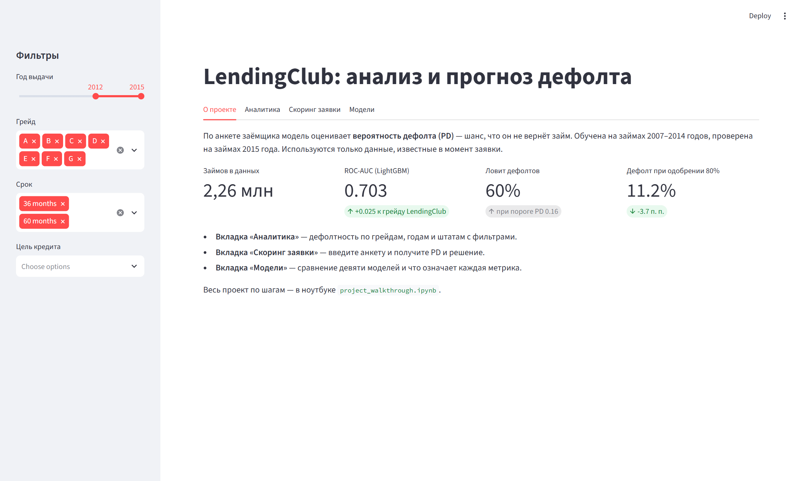
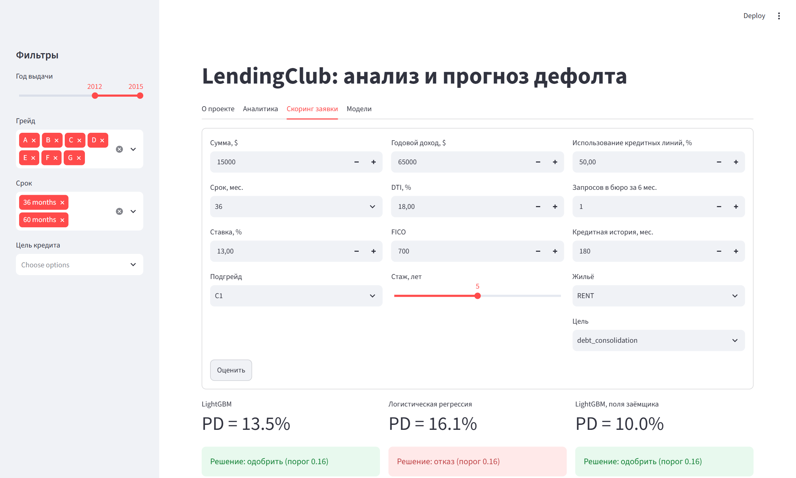

# LendingClub: анализ кредитного риска и прогноз дефолта

Итоговый проект по дисциплине **Programming for Data Analysis and Database** (Applied AI, магистратура).
Тема №33: *Loan Default Prediction (LendingClub)*. Команда: Kilybayev Yersaiyn, Участник 2, Участник 3 (AAI-2602M).

**Задача:** по данным, известным до выдачи займа, предсказать вероятность дефолта (PD)
и проверить, насколько грейды LendingClub отражают реальный риск.

## Дашборд Streamlit

`streamlit run app.py` — четыре вкладки: «О проекте» (главные цифры), «Аналитика» (дефолтность с фильтрами),
«Скоринг заявки» (PD и решение трёх моделей) и «Модели» (сравнение девяти моделей и смысл метрик).




## Быстрый запуск: без скачивания данных

Нужен Python 3.11. Демо-выборка (50 тыс. займов) и обученные модели уже лежат в репозитории.

```bash
python -m venv .venv
.venv\Scripts\activate            # Linux/macOS: source .venv/bin/activate
pip install -r requirements.txt

streamlit run app.py              # дашборд: аналитика с фильтрами, скоринг заявки, метрики
python main.py --sample           # консольное меню на демо-выборке
python main.py --sample --run-all # весь пайплайн на выборке, около 1 минуты
pytest                            # тесты, около 2 минут
```

## С чего начать чтение

1. **`project_walkthrough.ipynb` — главный файл проекта.** Весь проект по шагам: данные, аудит, SQL, разведочный анализ
   (14 графиков), девять моделей, анализ результатов (ROC и PR, пороги, калибровка, важность признаков, таблица одобрения),
   сравнение способов обработки данных и соответствие требованиям. Сохранён с результатами расчёта на полном наборе
   (2,26 млн займов), поэтому его можно просто открыть на GitHub.
2. **`docs/guide.pdf` — пояснительная записка к ноутбуку.** Каждая ячейка: код, подробное объяснение,
   результат; справочник всех функций; вопросы к защите с ответами; глоссарий.
3. **`docs/report.pdf` — официальный отчёт** и **`docs/presentation.pptx` — презентация** для Moodle.

Чтобы выполнить ноутбук самому, откройте его в VS Code или Jupyter из корня проекта: с файлом Kaggle в `datasets/`
он пересчитает всё на полных данных (около 30 минут), без него переключится на демо-выборку (2–3 минуты).
Сборка: `python docs/build_notebook.py`, затем `python docs/build_guide.py`.

В демо-режиме результаты пишутся в `sample_run/`, опубликованные отчёты в `reports/` не меняются.
Пункт 8 (бенчмарки) в этом режиме пропускается: ему нужен исходный CSV.
Доли и дефолтность на выборке не отражают полный набор, потому что созревшие займы взяты в ней с запасом.

## Полный запуск

1. Скачайте [All Lending Club loan data (Kaggle)](https://www.kaggle.com/datasets/wordsforthewise/lending-club).
2. Положите файл **без распаковки** в `datasets/accepted_2007_to_2018Q4.csv.gz`
   (2,26 млн займов, 151 колонка, 374 МБ в сжатом виде).
3. Выполните `python main.py --run-all` (около 11 минут) или `python main.py` и выберите пункт 9.

| № | Действие | Результат |
|---|---|---|
| 1 | CSV.gz → Parquet чанками по 250 тыс. строк | `data/loans.parquet`, `reports/ingest.json` |
| 2 | Аудит качества данных | `reports/audit.json`, `01_missing.png` |
| 3 | Нормализованная база SQLite | `db/lending.db` |
| 4 | 10 аналитических SQL-запросов | `reports/sql/*.csv` |
| 5 | EDA: 6 статических и 2 интерактивных графика | `reports/figures/` |
| 6 | Подбор гиперпараметров, обучение, сравнение, SHAP, чувствительность | `models/`, `reports/*.csv` |
| 7 | Оценка заявки, введённой вручную | PD и решение |
| 8 | Бенчмарки: память, CSV vs Parquet, Pandas vs SQL, память обучения моделей | `reports/benchmarks.json` |

## Структура

```
main.py              консольное меню и запуск без меню
app.py               дашборд Streamlit
project_walkthrough.ipynb  ноутбук: проект по шагам с результатами
src/config.py        пути, списки колонок, окно моделирования, правило выбора модели
src/data_io.py       чанковое чтение, Parquet, оптимизация типов, демо-выборка, замеры памяти
src/profiling.py     замер времени и пиковой памяти процесса
src/audit.py         аудит: пропуски, дубликаты, некорректные значения, выбросы IQR
src/features.py      таргет, отбор созревших займов, очистка, признаки, временной сплит
src/database.py      схема SQLite, загрузка, выполнение запросов -> Pandas
src/eda.py           графики
src/models.py        пайплайны sklearn, подбор, калибровка, метрики, выбор модели, скоринг
src/explain.py       ROC/PR, калибровка, SHAP, ошибки по грейдам, таблица одобрения
src/censoring.py     чувствительность результата к цензурированию
src/benchmark.py     сравнение способов обработки данных в отдельных процессах
src/style.py         единый стиль графиков
sql/schema.sql       DDL нормализованной схемы
sql/queries.sql      аналитические запросы
tests/               pytest: unit и integration
docs/                ER-диаграмма, отчёт, презентация, шпаргалка к защите и их сборка
data/sample/         демо-выборка 50 тыс. займов
models/              обученные модели и реестр порогов и калибровки
reports/             метрики, таблицы и графики полного запуска
```

## Методология

**Целевая переменная.** `Fully Paid` → 0, `Charged Off` / `Default` → 1.

**Только созревшие займы.** В модель попадают займы, срок которых истёк к декабрю 2018 г.:
на 36 месяцев с выдачей до 2015 г. включительно, на 60 месяцев до 2013 г. включительно.
Простое исключение статуса `Current` не решает проблему: среди незрелых займов завершены только
досрочно погашенные и уже списанные, поэтому дефолтность по ним смещена.
Следствие: **тест содержит только займы на 36 месяцев**, вне времени 60-месячные займы не проверены.

**Без утечки данных.**
- В модель идут только поля, известные до выдачи: 43 признака из анкеты, условий займа и кредитного отчёта заёмщика.
  Поля, появляющиеся позже (`total_pymnt`, `recoveries`, `last_pymnt_d`, `last_fico_range_*`, `out_prncp`,
  `debt_settlement_flag` и др.), исключены, это проверяет тест.
  `total_pymnt` используется только для оценки доходности портфеля, но не как признак.
- 16 полей кредитного отчёта (`acc_open_past_24mths`, `bc_util`, `total_bc_limit` и др.) LendingClub публикует с августа 2012 г.
  Аудит проверяет, что они относятся к моменту заявки: возраст самого старого счёта ни у одного из
  2 190 391 займа не превышает длину кредитной истории на дату выдачи больше чем на год.
- Штат заёмщика (`addr_state`) в модель не входит: на валидации он не улучшал качество, а в реальном скоринге
  такой признак требует проверки на справедливость.
- Разбиение по дате выдачи: **train 2007–2014** (393 276 займов), **test 2015** (283 026 займов).
- Подбор гиперпараметров: `TimeSeriesSplit` на 2007–2013, без 2014 года, по которому выбирается модель.
- Порог и калибровка Платта подбираются на 2014 годе по пробной модели (обучена на 2007–2013)
  и только потом применяются к финальной модели (обучена на 2007–2014) на test.
- Импутация, обрезка выбросов и кодирование категорий обучаются только на train внутри `Pipeline`.

**Поля, назначенные LendingClub.** `grade`, `sub_grade`, `int_rate`, `installment`, `installment_to_income`,
`initial_list_status`, `verification_status` не указывает заёмщик. Это не будущая информация,
но и не поля анкеты, поэтому модели обучены в двух вариантах: на всех полях и только на полях заёмщика.

**Модели.** Два baseline (константа и «только подгрейд»), логистическая регрессия и LightGBM. По мотивам открытых решений
на Kaggle добавлены претенденты: XGBoost, нейросеть прямого распространения (`MLPClassifier`) и ансамбль, который
усредняет вероятности LightGBM, XGBoost и нейросети.

**Выбор модели** зафиксирован до этого запуска и применяется к валидации, а не к тесту: лучшая ROC-AUC на 2014 годе;
логистическая регрессия выбирается, если отстаёт менее чем на 0,005. Претендент заменяет выбранную модель,
только если лучше её на валидации на 0,005 или больше: разница меньше этого лежит в пределах шума.

## Результаты (test: созревшие займы 2015 г., дефолтность 14,9%)

| Модель | Valid AUC | Test AUC | PR-AUC | ECE | Обучение, с | Память, МБ | Размер, МБ |
|---|---|---|---|---|---|---|---|
| Dummy (доля дефолтов) | 0.500 | 0.500 | 0.149 | 0.0003 | 0.0 | 10 | 0.00 |
| Только подгрейд LC (LogReg) | 0.659 | 0.679 | 0.251 | 0.0202 | 1.0 | 40 | 0.00 |
| Logistic Regression | 0.680 | 0.695 | 0.271 | 0.0106 | 11.7 | 664 | 0.01 |
| **LightGBM, выбран** | **0.689** | **0.703** | **0.283** | **0.0093** | **7.7** | **238** | **0.53** |
| XGBoost | 0.688 | 0.703 | 0.283 | 0.0100 | 17.0 | 309 | 0.51 |
| Нейросеть (MLP) | 0.679 | 0.696 | 0.272 | 0.0057 | 14.1 | 699 | 0.22 |
| Ансамбль: LightGBM + XGBoost + MLP | 0.689 | 0.704 | 0.283 | 0.0077 | 29.5 | 658 | 1.26 |
| Logistic Regression (поля заёмщика) | 0.668 | 0.678 | 0.258 | 0.0102 | 4.7 | 340 | 0.01 |
| LightGBM (поля заёмщика) | 0.681 | 0.693 | 0.272 | 0.0085 | 5.5 | 208 | 0.52 |

**Решения «одобрить / отказать»** при пороге, подобранном по максимуму F1 на валидации (заём с PD не ниже порога — отказ):

| Модель | Порог PD | Accuracy | Precision | Recall | F1 |
|---|---|---|---|---|---|
| Dummy (доля дефолтов) | 0.05 | 0.149 | 0.149 | 1.000 | 0.259 |
| Только подгрейд LC (LogReg) | 0.15 | 0.660 | 0.237 | 0.575 | 0.335 |
| Logistic Regression | 0.16 | 0.679 | 0.250 | 0.579 | 0.349 |
| **LightGBM, выбран** | **0.16** | **0.676** | **0.252** | **0.600** | **0.355** |
| XGBoost | 0.17 | 0.698 | 0.261 | 0.561 | 0.356 |
| Нейросеть (MLP) | 0.15 | 0.639 | 0.238 | 0.646 | 0.348 |
| Ансамбль: LightGBM + XGBoost + MLP | 0.16 | 0.672 | 0.251 | 0.608 | 0.356 |
| Logistic Regression (поля заёмщика) | 0.15 | 0.651 | 0.234 | 0.594 | 0.336 |
| LightGBM (поля заёмщика) | 0.16 | 0.676 | 0.247 | 0.575 | 0.345 |
| Константа «все вернут» (для сравнения) | — | 0.851 | — | 0.000 | 0.000 |

Accuracy обманчива: «все вернут» получает 0.851, не найдя ни одного дефолта, а Dummy при пороге 0.05 отказывает всем и получает 0.149. Поэтому модели сравниваются по ROC-AUC, а accuracy, precision и recall показывают решения при выбранном пороге.

Память: прирост пиковой памяти процесса за время обучения. Каждая модель обучается в отдельном процессе, в таблице медиана трёх запусков (пункт меню 8).

- **Выбран LightGBM** по заранее заданному правилу: на валидации он опережает логистическую регрессию на 0.008,
  это больше запаса 0.005. На тесте его преимущество 0.008. Логистическая регрессия остаётся простой альтернативой;
  оба варианта показаны в дашборде.
- **XGBoost, нейросеть и ансамбль** (идеи из открытых решений на Kaggle) не превзошли LightGBM заметно: ансамбль
  лучше на валидации на 0.0002, меньше запаса 0.005, поэтому выбор не меняется. Качество ограничено данными, а не алгоритмом.
- **Данные заёмщика воспроизводят грейд и превосходят его.** LightGBM только на полях заёмщика (AUC 0.693) обгоняет
  один подгрейд LendingClub (0.679). Это заслуга полей кредитного отчёта: на одних полях анкеты модель грейду уступала.
  Грейд и ставка добавляют к данным заёмщика ещё 0.011 AUC.
- **Цензурирование завышает результат.** На всех завершённых займах та же LightGBM показывает AUC 0.740, на созревших
  0.703. Внутри 36-месячных займов та же модель в смещённой когорте даёт 0.704: завышение создаётся смешением сроков.
- **Калибровка на 2014 годе** снижает ECE LightGBM с 0.0172 до 0.0093, порядок заёмщиков не меняется.
  Она подобрана на пробной модели (2007–2013) и перенесена на финальную: средняя PD после калибровки 14.0% при фактических 14.9%.
- **AUC на тесте выше, чем на валидации** (0.703 против 0.689), и это не утечка. Пробная модель даёт на тесте 0.696:
  0.007 объясняется тем, что займы 2015 года различить легче, ещё 0.007 добавляет 2014 год в обучении финальной модели.

**Таблица одобрения** (одобряем долю заявок с наименьшей PD). Доходность номинальная, за весь срок, без стоимости фондирования:

| Одобрено | Только подгрейд: дефолт / доход | Logistic Regression: дефолт / доход | LightGBM: дефолт / доход |
|---|---|---|---|
| 70% | 10.6% / 7.1% | 10.1% / 7.5% | 9.9% / 7.7% |
| 80% | 11.9% / 7.0% | 11.4% / 7.4% | 11.2% / 7.5% |
| 100% | 14.9% / 6.6% | 14.9% / 6.6% | 14.9% / 6.6% |

## Сравнение способов обработки данных

Каждый замер идёт в отдельном процессе, в таблице медиана трёх запусков. Память: прирост пиковой памяти процесса (RSS).

| Сравнение | Вариант A | Вариант B |
|---|---|---|
| Память: все 151 колонка vs 49 нужных + `category`/`float32` | ~3,1 ГБ | **386 МБ** (в 8 раз меньше) |
| Чтение 6 колонок, время: CSV.gz vs Parquet | 13,4 с | **0,3 с** |
| Чтение 6 колонок, пиковая память: CSV.gz vs Parquet | **162 МБ** | 234 МБ |
| Размер файла: CSV.gz vs Parquet (snappy, 49 колонок) | 374 МБ | **123 МБ** |
| Агрегация «дефолт по году и грейду», время: Pandas vs SQLite | **1,2 с** | 4,0 с |
| Та же агрегация, пиковая память: Pandas vs SQLite | 393 МБ | **5 МБ** |

Pandas с Parquet быстрее, SQLite почти не расходует память приложения. Результаты агрегации совпадают, это проверяется автоматически.
Ранняя версия проекта показывала обратный результат по времени: замер с `tracemalloc` замедлял Pandas.

## База данных

Нормализованная схема: справочники `dim_grade`, `dim_purpose`, `dim_state`, `dim_home`,
таблица фактов `loans` и таблицы `borrowers` (профиль на момент заявки) и `outcomes` (исход займа), обе 1:1 с `loans`.


Запросы (`sql/queries.sql`): дефолтность по грейдам (JOIN), цели с HAVING, винтажи и цензурирование,
рейтинг штатов (CTE + `RANK() OVER PARTITION BY`), скользящее среднее за 3 месяца (`AVG() OVER ROWS`),
прирост год к году (`LAG`), децили DTI (`NTILE`), доход относительно среднего по подгрейду (подзапрос),
потери по списанным займам, матрица FICO и типа жилья. Результаты идут в графики EDA и отчёт.

## Качество кода

```bash
pytest --cov=src --cov=main --cov=app   # 117 тестов, покрытие 94%
ruff check .
python docs/build_er.py       # ER-диаграмма из sql/schema.sql
python docs/build_report.py   # docs/report.docx из reports/ (в репозиторий идёт PDF)
python docs/build_deck.py     # docs/presentation.pptx из reports/; нужен шаблон Canva template.pptx в корне
```

## Команда и вклад

| Участник | Что сделал |
|---|---|
| Kilybayev Yersaiyn | загрузка CSV частями и Parquet, оптимизация типов, аудит качества, схема SQLite, ER-диаграмма, SQL-запросы, бенчмарки памяти и скорости |
| Участник 2 | разведочный анализ и графики, консольное меню main.py, дашборд Streamlit |
| Участник 3 | признаки и временное разбиение, обучение и сравнение моделей, калибровка и порог, интерпретация (SHAP), анализ ошибок |

Общая работа — постановка задачи, выбор методики, ноутбук, отчёт и презентация.

## Использование ИИ

При работе над проектом использовался ИИ-ассистент Claude Code (Anthropic). Команда выбрала тему и данные, построила исходную версию конвейера (загрузка и очистка данных, база и SQL-запросы, разведочный анализ, первые модели, дашборд) и принимала ключевые решения по методике. ИИ использовался для рецензирования кода и методики (в том числе указал на смещение из-за незавершённых займов), рефакторинга, тестов, оформления ноутбука и черновиков документации. Все результаты команда проверила и отвечает за содержание работы.

## Ограничения

- Метки обучающих займов 2013–2014 гг. на момент 2015 года ещё не были известны полностью. В реальной работе банка
  обучающее окно было бы старше; строгий вариант оставил бы слишком мало данных.
- Тест содержит только займы на 36 месяцев. Калибровка тоже подобрана на них, поэтому PD для 60 месяцев менее надёжна.
- Есть только одобренные заявки, reject inference не выполнялся.
- Данные американского P2P-кредитования; перенос на другой рынок требует переобучения.
- Поля кредитного отчёта есть только у займов с августа 2012 г. LendingClub не публикует дату, на которую они сняты;
  их отнесение к моменту заявки подтверждено проверкой в аудите, а не документацией.
- Набор признаков расширялся после первой версии проекта, когда её результаты на тесте уже были известны.
  Состав признаков и гиперпараметры выбирались только по валидации 2014 года, но итоговую оценку нельзя считать полностью слепой.
- Порог по максимуму F1 показан для сравнения моделей. Настоящий порог задаётся риск-аппетитом, см. таблицу одобрения.
