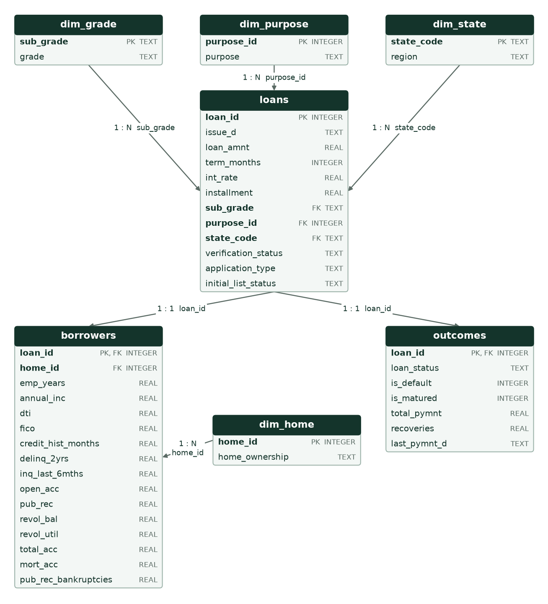

# LendingClub: анализ кредитного риска и прогноз дефолта

Итоговый проект по дисциплине **Programming for Data Analysis and Database** (Applied AI, магистратура).
Тема №33: *Loan Default Prediction (LendingClub)*. Автор: Kilybayev Yersaiyn, AAI-2602M.

**Задача:** по данным, известным до выдачи займа, предсказать вероятность дефолта (PD)
и проверить, насколько грейды LendingClub отражают реальный риск.

## Быстрый запуск: без скачивания данных

Нужен Python 3.11. Демо-выборка (50 тыс. займов) и обученные модели уже лежат в репозитории.

```bash
python -m venv .venv
.venv\Scripts\activate            # Linux/macOS: source .venv/bin/activate
pip install -r requirements.txt

streamlit run app.py              # дашборд: аналитика с фильтрами, скоринг заявки, метрики
python main.py --sample           # консольное меню на демо-выборке
python main.py --sample --run-all # весь пайплайн на выборке, около 1 минуты
pytest                            # тесты, около 3 минут
```

В демо-режиме результаты пишутся в `sample_run/`, опубликованные отчёты в `reports/` не меняются.
Пункт 8 (бенчмарки) в этом режиме завершится сообщением об ошибке: ему нужен исходный CSV.
Доли и дефолтность на выборке не отражают полный набор, потому что созревшие займы взяты в ней с запасом.

## Полный запуск

1. Скачайте [All Lending Club loan data (Kaggle)](https://www.kaggle.com/datasets/wordsforthewise/lending-club).
2. Положите файл **без распаковки** в `datasets/accepted_2007_to_2018Q4.csv.gz`
   (2,26 млн займов, 151 колонка, 374 МБ в сжатом виде).
3. Выполните `python main.py --run-all` (около 10 минут) или `python main.py` и выберите пункт 9.

| № | Действие | Результат |
|---|---|---|
| 1 | CSV.gz → Parquet чанками по 250 тыс. строк | `data/loans.parquet`, `reports/ingest.json` |
| 2 | Аудит качества данных | `reports/audit.json`, `01_missing.png` |
| 3 | Нормализованная база SQLite | `db/lending.db` |
| 4 | 10 аналитических SQL-запросов | `reports/sql/*.csv` |
| 5 | EDA: 6 статических и 2 интерактивных графика | `reports/figures/` |
| 6 | Подбор гиперпараметров, обучение, сравнение, SHAP, чувствительность | `models/`, `reports/*.csv` |
| 7 | Оценка заявки, введённой вручную | PD и решение |
| 8 | Бенчмарки: память, CSV vs Parquet, Pandas vs SQL | `reports/benchmarks.json` |

## Структура

```
main.py              консольное меню и запуск без меню
app.py               дашборд Streamlit
src/config.py        пути, списки колонок, окно моделирования, правило выбора модели
src/data_io.py       чанковое чтение, Parquet, оптимизация типов, демо-выборка, замеры памяти
src/profiling.py     замер времени и пиковой памяти процесса
src/audit.py         аудит: пропуски, дубликаты, некорректные значения, выбросы IQR
src/features.py      таргет, отбор созревших займов, очистка, признаки, временной сплит
src/database.py      схема SQLite, загрузка, выполнение запросов -> Pandas
src/eda.py           графики
src/models.py        пайплайны sklearn, подбор, калибровка, метрики, выбор модели, скоринг
src/explain.py       ROC/PR, калибровка, SHAP, ошибки по грейдам, таблица одобрения
src/censoring.py     чувствительность результата к цензурированию
src/benchmark.py     сравнение способов обработки данных в отдельных процессах
src/style.py         единый стиль графиков
sql/schema.sql       DDL нормализованной схемы
sql/queries.sql      аналитические запросы
tests/               pytest: unit и integration
docs/                ER-диаграмма, отчёт, презентация, шпаргалка к защите и их сборка
data/sample/         демо-выборка 50 тыс. займов
models/              обученные модели и реестр порогов и калибровки
reports/             метрики, таблицы и графики полного запуска
```

## Методология

**Целевая переменная.** `Fully Paid` → 0, `Charged Off` / `Default` → 1.

**Только созревшие займы.** В модель попадают займы, срок которых истёк к декабрю 2018 г.:
на 36 месяцев с выдачей до 2015 г. включительно, на 60 месяцев до 2013 г. включительно.
Простое исключение статуса `Current` не решает проблему: среди незрелых займов завершены только
досрочно погашенные и уже списанные, поэтому дефолтность по ним смещена.
Следствие: **тест содержит только займы на 36 месяцев**, вне времени 60-месячные займы не проверены.

**Без утечки данных.**
- В модель идут только поля, известные до выдачи. Поля, появляющиеся позже (`total_pymnt`, `recoveries`,
  `last_pymnt_d`, `last_fico_range_*`, `out_prncp`, `debt_settlement_flag` и др.), исключены, это проверяет тест.
  `total_pymnt` используется только для оценки доходности портфеля, но не как признак.
- Разбиение по дате выдачи: **train 2007–2014** (393 276 займов), **test 2015** (283 026 займов).
- Подбор гиперпараметров: `TimeSeriesSplit` на train. Порог и калибровка Платта подбираются на 2014 годе
  (модель обучена на 2007–2013) и только потом применяются к test.
- Импутация, обрезка выбросов и кодирование категорий обучаются только на train внутри `Pipeline`.

**Поля, назначенные LendingClub.** `grade`, `sub_grade`, `int_rate`, `installment`, `installment_to_income`,
`initial_list_status`, `verification_status` не указывает заёмщик. Это не будущая информация,
но и не поля анкеты, поэтому модели обучены в двух вариантах: на всех полях и только на полях заёмщика.

**Выбор модели** зафиксирован до этого запуска и применяется к валидации, а не к тесту: лучшая ROC-AUC на 2014 годе;
логистическая регрессия выбирается, если отстаёт менее чем на 0,005.

## Результаты (test: созревшие займы 2015 г., дефолтность 14,9%)

| Модель | Valid AUC | Test AUC | Gini | KS | PR-AUC | Brier | ECE | Обучение, с | Память, МБ | Размер, МБ |
|---|---|---|---|---|---|---|---|---|---|---|
| Dummy (доля дефолтов) | 0.500 | 0.500 | 0.000 | 0.000 | 0.149 | 0.1267 | 0.0003 | 0.0 | 0 | 0.00 |
| Только подгрейд LC (LogReg) | 0.659 | 0.679 | 0.357 | 0.262 | 0.251 | 0.1209 | 0.0202 | 0.5 | 56 | 0.00 |
| **Logistic Regression, выбрана** | **0.673** | **0.689** | **0.378** | **0.277** | **0.261** | **0.1198** | **0.0105** | **6.0** | **422** | **0.01** |
| LightGBM | 0.677 | 0.697 | 0.393 | 0.286 | 0.274 | 0.1190 | 0.0116 | 5.6 | 156 | 1.02 |
| Logistic Regression (поля заёмщика) | 0.653 | 0.659 | 0.318 | 0.229 | 0.238 | 0.1218 | 0.0105 | 3.8 | 317 | 0.01 |
| LightGBM (поля заёмщика) | 0.663 | 0.674 | 0.349 | 0.253 | 0.253 | 0.1207 | 0.0103 | 4.5 | 126 | 1.02 |

Память: прирост пиковой памяти процесса при обучении. Замеры идут подряд в одном процессе, поэтому это ориентир, а не точное значение.

- **Цензурирование завышало результат.** На всех завершённых займах та же LightGBM показывает AUC 0.736, на созревших
  0.697. Внутри 36-месячных займов та же модель в смещённой когорте даёт 0.697: завышение создаётся смешением сроков.
- **Выбрана логистическая регрессия** по заранее заданному правилу: на валидации она отстала от LightGBM на 0.004.
  На тесте LightGBM лучше на 0.008, но менять выбор по тесту нельзя, это была бы подгонка. Оба варианта показаны в дашборде.
- **Грейд сильнее данных заёмщика.** Один подгрейд (AUC 0.679) обгоняет LightGBM на всех полях заёмщика (0.674).
  Поля LendingClub добавляют LightGBM 0.022 AUC. Полная модель лучше одного подгрейда лишь на 0.018.
- **Калибровка на 2014 годе** снижает ECE логистической регрессии с 0.0184 до 0.0105, порядок заёмщиков не меняется.

**Таблица одобрения** (одобряем долю заявок с наименьшей PD). Доходность номинальная, за весь срок, без стоимости фондирования:

| Одобрено | Только подгрейд: дефолт / доход | Logistic Regression: дефолт / доход | LightGBM: дефолт / доход |
|---|---|---|---|
| 70% | 10.6% / 7.1% | 10.3% / 7.3% | 10.1% / 7.5% |
| 80% | 11.9% / 7.0% | 11.6% / 7.2% | 11.4% / 7.4% |
| 100% | 14.9% / 6.6% | 14.9% / 6.6% | 14.9% / 6.6% |

## Сравнение способов обработки данных

Каждый замер идёт в отдельном процессе, в таблице медиана трёх запусков. Память: прирост пиковой памяти процесса (RSS).

| Сравнение | Вариант A | Вариант B |
|---|---|---|
| Память: все 151 колонка vs 33 нужных + `category`/`float32` | ~3,1 ГБ | **248 МБ** (в 12 раз меньше) |
| Чтение 6 колонок, время: CSV.gz vs Parquet | 9,4 с | **0,2 с** |
| Чтение 6 колонок, пиковая память: CSV.gz vs Parquet | **162 МБ** | 227 МБ |
| Размер файла: CSV.gz vs Parquet (snappy, 33 колонки) | 374 МБ | **76 МБ** |
| Агрегация «дефолт по году и грейду», время: Pandas vs SQLite | **0,8 с** | 2,6 с |
| Та же агрегация, пиковая память: Pandas vs SQLite | 387 МБ | **5 МБ** |

Pandas с Parquet быстрее, SQLite почти не расходует память приложения. Результаты агрегации совпадают, это проверяется автоматически.
Ранняя версия проекта показывала обратный результат по времени: замер с `tracemalloc` замедлял Pandas.

## База данных

Нормализованная схема: справочники `dim_grade`, `dim_purpose`, `dim_state`, `dim_home`,
таблица фактов `loans` и таблицы `borrowers` (профиль на момент заявки) и `outcomes` (исход займа), обе 1:1 с `loans`.



Запросы (`sql/queries.sql`): дефолтность по грейдам (JOIN), цели с HAVING, винтажи и цензурирование,
рейтинг штатов (CTE + `RANK() OVER PARTITION BY`), скользящее среднее за 3 месяца (`AVG() OVER ROWS`),
прирост год к году (`LAG`), децили DTI (`NTILE`), доход относительно среднего по подгрейду (подзапрос),
потери по списанным займам, матрица FICO и типа жилья. Результаты идут в графики EDA и отчёт.

## Качество кода

```bash
pytest --cov=src --cov=main   # 97 тестов, покрытие 93%
ruff check .
python docs/build_er.py       # ER-диаграмма из sql/schema.sql
python docs/build_report.py   # docs/report.docx из reports/
python docs/build_deck.py     # docs/presentation.pptx из reports/
```

## Ограничения

- Метки обучающих займов 2013–2014 гг. на момент 2015 года ещё не были известны полностью. В реальной работе банка
  обучающее окно было бы старше; строгий вариант оставил бы слишком мало данных.
- Тест содержит только займы на 36 месяцев. Калибровка тоже подобрана на них, поэтому PD для 60 месяцев менее надёжна.
- Есть только одобренные заявки, reject inference не выполнялся.
- Данные американского P2P-кредитования; перенос на другой рынок требует переобучения.
- `addr_state` влияет на прогноз. В реальном скоринге такой признак нужно проверять на справедливость и законность.
- Порог по максимуму F1 показан для сравнения моделей. Настоящий порог задаётся риск-аппетитом, см. таблицу одобрения.
